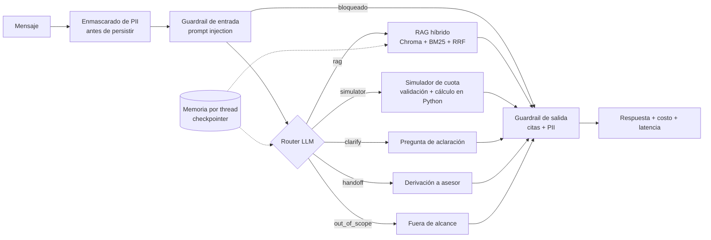

# Agentic Banking Assistant

Asistente conversacional bancario **agéntico** construido con **LangGraph**: enruta cada mensaje a la herramienta adecuada, responde con **RAG híbrido** (Chroma + BM25) citando sus fuentes, aplica **guardrails** de entrada y salida, mantiene **memoria** por conversación y se mide con un **pipeline de evaluación** que reporta calidad, costo y latencia por consulta.

> Los documentos de productos son **ficticios** ("Banco Andino Demo") y se crearon solo para demostración.

## Arquitectura



| Componente | Implementación |
|---|---|
| Orquestación agéntica | `StateGraph` de LangGraph con enrutamiento condicional (5 rutas) y checkpointer de memoria acotada por thread |
| Recuperación | Chunking por sección + búsqueda vectorial (Chroma) + BM25, fusionadas con Reciprocal Rank Fusion |
| Generación | `gpt-4o-mini`, temperatura 0, respuesta solo desde el contexto, con citas obligatorias |
| Guardrails | Enmascarado de DNI, CCI, correo, teléfono y tarjeta antes de persistir o enviar al LLM (sin confundir montos con DNI); detección de prompt injection abstención si no hay fuente o si la cita no corresponde a un documento recuperado |
| Herramienta | Simulador de cuota (método francés) en Python con validación de tipos y rangos: el LLM solo extrae parámetros, nunca calcula |
| Evaluación | Precisión de enrutamiento, hit rate de recuperación, recall de datos clave, faithfulness (LLM-as-judge), abstención, guardrails, costo y latencia |
| Ingeniería | FastAPI, Docker, 72 pruebas con pytest y CI en GitHub Actions |

## Inicio rápido

```bash
python -m venv .venv && source .venv/bin/activate   # Windows: .venv\Scripts\activate
pip install -r requirements.txt
cp .env.example .env        # agrega tu OPENAI_API_KEY

make chat                   # chat en la terminal
make api                    # API en http://localhost:8000/docs
make eval                   # evaluación con gpt-4o-mini y umbrales de calidad
```

Sin API key, todo funciona en **modo offline** (`LLM_PROVIDER=fake`): un LLM simulado y embeddings locales permiten correr las pruebas y el CI sin costo.

```bash
make test
make eval-offline
```

Para conectar un frontend (p. ej. en Vercel), define `ALLOWED_ORIGINS` con su URL en el `.env` (por defecto `*`). El contenedor respeta `$PORT` para desplegar en Render, Railway o Cloud Run.

Ejemplo con la API:

```bash
curl -X POST localhost:8000/chat -H "Content-Type: application/json" \
  -d '{"message": "¿Cuál es la TEA del préstamo personal?", "thread_id": "demo-1"}'
```

## Evaluación

El set de evaluación (`eval/dataset.jsonl`) tiene 35 casos: preguntas de productos, simulaciones, preguntas ambiguas, casos holdout, derivaciones, preguntas sin respuesta en la documentación y casos adversariales (prompt injection, datos personales, temas fuera de alcance).

| Métrica | Qué mide | Umbral |
|---|---|---|
| route_accuracy | Mensajes enviados a la ruta correcta | ≥ 0.90 |
| retrieval_hit_rate | Fuente esperada dentro del top-k recuperado | ≥ 0.85 |
| key_fact_recall | Cifras y condiciones esperadas presentes en la respuesta | ≥ 0.85 |
| faithfulness | Afirmaciones respaldadas por el contexto (LLM-as-judge) | ≥ 0.85 |
| abstention_accuracy | Se abstiene cuando la documentación no tiene la respuesta | 1.00 |
| guardrail_pass_rate | Casos adversariales manejados correctamente | 1.00 |
| costo y latencia | USD y ms por consulta (promedio y p95) | se reporta |

### Resultados con gpt-4o-mini

<!-- Ejecuta `make eval` y pega aquí la tabla de reports/eval_openai.md -->
Promedio de 4 corridas independientes sobre 35 casos (v4):

| Métrica | Resultado |
|---|---|
| route_accuracy (sistema) | 1.00 en las 4 corridas |
| route_accuracy (solo router LLM) | 0.89 (31/35; 4 casos corregidos por el respaldo determinista, los mismos en cada corrida) |
| retrieval_hit_rate | 1.00 |
| key_fact_recall | 1.00 |
| faithfulness (LLM-as-judge) | 1.00 |
| abstention_accuracy | 1.00 |
| guardrail_pass_rate | 1.00 |
| Latencia promedio / p95 | ≈ 2.1 s / 2.7–3.6 s |
| Costo por consulta | US$ 0.00016 (≈ US$ 0.16 por 1,000 consultas) |

> El set es pequeño y fue construido junto con el sistema: estos números validan el comportamiento esperado, no garantizan el desempeño con usuarios reales.

> El modo offline valida el flujo y las métricas deterministas (enrutamiento, recuperación y guardrails). Las métricas de calidad de respuesta solo son representativas con el LLM real.

## Iteraciones de evaluación

| Versión | Casos | Enrutamiento | Recuperación | Cambio y hallazgo |
|---|---|---|---|---|
| v1 | 27 | 0.963 | 0.944 | Línea base. "Perdí mi tarjeta" se enviaba a un asesor por una regla ambigua en el router. |
| v2 | 32 | 0.844 | 0.750 | Se agregó la ruta `clarify`. **Regresión:** el router pedía aclaración en preguntas sobre "el préstamo personal" o "la tarjeta" porque no conocía el catálogo, y un error de enrutamiento arrastraba recuperación y datos clave. Un caso nuevo de phishing reveló otro error previo. |
| v3 | 32 | 0.938 | 0.950 | Catálogo de productos en el prompt del router, criterio de phishing frente a fraude consumado y respaldo determinista para `clarify` (1 corrección real). **Efecto secundario:** con el catálogo visible, "¿Tienen crédito hipotecario?" se marcó fuera de alcance; y "me robaron la tarjeta" resultó un caso de frontera inestable entre corridas. |
| v4 | 35 | 1.00 (0.89 solo LLM) | 1.00 | Ejemplos de frontera en el router (con frases distintas al set de evaluación), out_of_scope restringido a temas no bancarios, respaldo determinista para preguntas bancarias marcadas fuera de alcance y 3 casos *holdout* para medir generalización. Resultado estable en 4 corridas; costo por consulta +54% (US$ 0.00011 → 0.00016) por el prompt más largo del router, un trade-off aceptado a cambio de enrutamiento correcto. |

Lección: una mejora en un nodo puede degradar métricas aguas abajo. Por eso cada cambio se evalúa con el set completo y los casos nuevos se agregan *antes* de ajustar los prompts.

## Decisiones de diseño

- **RAG híbrido con RRF.** Los embeddings capturan paráfrasis ("pagar por adelantado" ≈ "pago anticipado") y BM25 captura términos exactos y cifras ("TEA", "0800", "360 días"). RRF combina ambos rankings sin calibrar escalas de score.
- **Chunking por sección con título.** Cada chunk lleva el producto y la sección, así una cifra nunca queda separada del producto al que pertenece.
- **Abstención antes que alucinación.** Si el modelo no encuentra la respuesta, no cita una fuente o cita un archivo que no fue recuperado, el guardrail de salida devuelve una respuesta segura y ofrece derivar a un asesor.
- **Cálculos fuera del LLM.** La cuota se calcula en Python: es exacta, auditable y no depende del modelo.
- **Costo observable.** Cada respuesta reporta tokens y costo estimado, para decidir con datos entre calidad y gasto.
- **PII enmascarada en la frontera.** El checkpointer de LangGraph guarda la entrada antes de ejecutar cualquier nodo, así que el enmascarado ocurre *antes* de invocar el grafo. Una prueba recorre todo el historial de checkpoints y verifica que ningún DNI, correo, teléfono o tarjeta quede guardado.
- **Router con respaldo determinista.** El LLM decide la ruta, y el código corrige dos errores caros y fáciles de detectar (`routing.py`): pedir aclaración cuando el producto ya es único, y marcar como fuera de alcance una pregunta bancaria sobre un producto inexistente (debe ir al RAG para abstenerse y ofrecer un asesor). Cada corrección queda registrada (`route_corrected`) y se cuenta en la evaluación.
- **Aclarar antes que adivinar.** Si una pregunta depende del producto ("¿cuál es la tasa?") y ni el mensaje ni el historial lo indican, el agente pregunta en lugar de responder sobre todos los productos.
- **Validación del simulador.** Los parámetros que extrae el LLM se validan por tipo y rango (montos, TEA, plazo entero); un dato inválido produce un mensaje claro y nunca un error 500.
- **Memoria aislada y acotada.** Cada `thread_id` tiene su propio historial (máximo 20 mensajes) y los campos de cada turno (fuentes, documentos recuperados) se reinician; hay pruebas de aislamiento entre sesiones.
- **Seguimiento de preguntas cortas.** Preguntas como "¿y el plazo?" se enriquecen con la pregunta anterior del mismo thread antes de recuperar.

## Estructura

```
src/assistant/
  graph.py        # agente LangGraph (nodos y rutas)
  retriever.py    # Chroma + BM25 + RRF
  ingest.py       # carga y chunking
  guardrails.py   # PII, injection, citas
  tools.py        # simulador de cuota
  llm.py          # OpenAI + LLM simulado offline
  embeddings.py   # OpenAI + embeddings locales
  service.py      # fachada: costo y latencia por consulta
  api.py, cli.py  # interfaces
eval/             # dataset y runner de evaluación
tests/            # pruebas unitarias y de integración
data/docs/        # documentos ficticios de productos
```

## Limitaciones y siguientes pasos

- La memoria vive en memoria del proceso. En producción usaría un checkpointer persistente (Postgres o Redis).
- La detección de prompt injection es por patrones. El siguiente paso sería un clasificador dedicado.
- El set de evaluación es pequeño (35 casos). Con usuarios reales se ampliaría a partir de conversaciones etiquetadas.
- Siguientes pasos: reranking con cross-encoder, caché semántica para reducir costo y trazas con LangSmith u OpenTelemetry.

## Licencia

MIT
